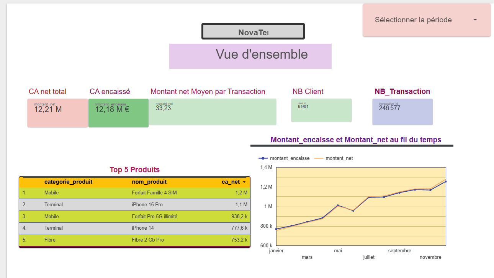
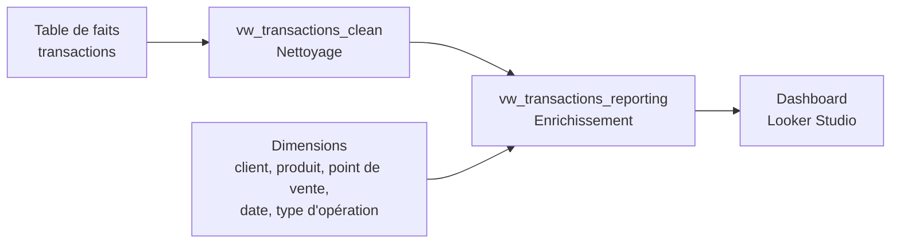

# NovaTel – Dashboard BI avec BigQuery et Looker Studio

Dashboard interactif de 5 pages pour analyser le chiffre d'affaires, les produits, les zones géographiques, les canaux de vente et les anomalies de NovaTel, un opérateur télécom (projet pédagogique).

**[👉 Voir le rapport Looker Studio](https://datastudio.google.com/reporting/2789147d-31bc-480a-85ba-9228e7c0b880)**



## Objectifs

- Construire une couche de reporting fiable dans BigQuery à partir de données nettoyées
- Connecter cette couche à Looker Studio, sans export CSV
- Concevoir un dashboard clair, filtrable et partageable
- Répondre à 17 questions métier
- Contrôler la cohérence entre les visuels et les requêtes SQL

## Stack technique

| Outil | Usage |
|---|---|
| **Google BigQuery** | Stockage, vues et requêtes SQL |
| **SQL** | Jointures, agrégations et calcul des indicateurs |
| **Looker Studio** | Visualisation, filtres et partage |

## Architecture des données



| Couche | Rôle |
|---|---|
| `vw_transactions_clean` | Exclut les lignes sans date, dédoublonne et met à zéro les montants des transactions annulées |
| `vw_transactions_reporting` | Ajoute les libellés métier grâce à 5 `LEFT JOIN`, et sert d'unique source à Looker Studio |

Les `LEFT JOIN` conservent toutes les transactions, même si une clé étrangère ne trouve pas de correspondance dans une dimension.

## Structure du dashboard

| Page | Contenu |
|---|---|
| **1. Vue d'ensemble** | KPI, évolution mensuelle du CA et top produits |
| **2. Analyse géographique** | CA par région |
| **3. Analyse produit** | CA par catégorie, sous-catégorie et marque |
| **4. Canaux de vente** | Comparaison physique / en ligne |
| **5. Anomalies et qualité** | Transactions annulées et montants nets négatifs |

Chaque page reprend le même en-tête : nom de l'entreprise, titre de la page, contrôle de plage de dates et ligne de séparation.

## Principaux résultats

### Chiffre d'affaires 2024

| Indicateur | Résultat |
|---|---|
| CA net | **7 677 292,51 €** |
| CA encaissé | **7 565 739,83 €** |
| CA non encaissé | **111 552,68 €** (1,45 % du CA net) |
| Mois le plus fort | Décembre : 750 300 € |
| Mois le plus faible | Janvier : 518 978 € |
| Croissance janvier → décembre | **+44,6 %** |
| Trimestre le plus fort | T4 : 2 181 362 € (28,4 % du CA) |
| Trimestre le plus faible | T1 : 1 612 067 € (21,0 % du CA) |

Le CA progresse à chaque trimestre. Les 3 meilleurs mois de l'année (octobre, novembre et décembre) forment le T4.

### Top 5 des produits par CA net (toute la période)

| Rang | Catégorie | Produit | CA net |
|---|---|---|---|
| 1 | Mobile | Forfait Famille 4 SIM | 1 151 579 € |
| 2 | Terminal | iPhone 15 Pro | 1 051 397 € |
| 3 | Mobile | Forfait Pro 5G illimité | 938 199 € |
| 4 | Terminal | iPhone 14 | 777 635 € |
| 5 | Fibre | Fibre 2 Gb Pro | 753 179 € |

## Questions métier

| Groupe | Questions |
|---|---|
| **A. Chiffre d'affaires** | Évolution mensuelle, CA encaissé vs net, meilleurs mois, trimestres |
| **B. Produits et catégories** | Catégories, marques, montant net moyen, taux de remboursement |
| **C. Géographie et canaux** | Régions, sous-performance, canaux, volume par ville |
| **D. Segments et anomalies** | Segments clients, annulations, montants négatifs, combinaisons région × catégorie, types d'opération |

## Exemple de requête

Calcul du taux de remboursement par sous-catégorie :

```sql
SELECT
  sous_categorie,
  ROUND(SAFE_DIVIDE(SUM(remboursement), SUM(montant_brut)) * 100, 2) AS taux_remboursement_pct
FROM `VOTRE_PROJET.novatel.vw_transactions_reporting`
GROUP BY sous_categorie
ORDER BY taux_remboursement_pct DESC
LIMIT 5;
```

## Contrôle qualité

- Comparaison des scorecards avec les requêtes de référence BigQuery
- Vérification de l'absence de libellés `(vide)` dans les visuels
- Vérification de la période couverte par les séries temporelles
- Test du lien de partage en navigation privée

## Compétences mises en œuvre

Modélisation en couches · SQL analytique · Création de vues · Visualisation de données · Conception de KPI · Contrôle qualité · Partage et gestion des droits

## Auteur

**Sunhyea Sakong**
